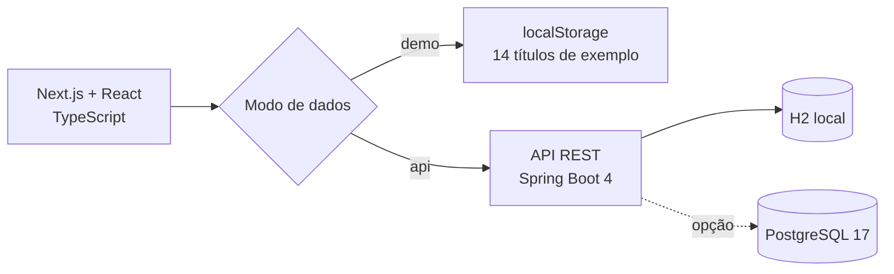

<div align="center">

# ✦ Entrelinhas

### Todas as suas histórias, em um só lugar.

**Um ateliê de leitura para transformar um acervo de livros em uma experiência pessoal.**

Organize sua biblioteca, acompanhe páginas lidas, estabeleça metas e descubra seus hábitos por meio de uma interface editorial e responsiva.


**[Visão geral](#-sobre-o-projeto)** · **[Funcionalidades](#-o-que-é-possível-fazer)** · **[Executar](#-comece-pelo-modo-demonstração)** · **[API](#-api-rest)** · **[Estrutura](#-estrutura-do-repositório)**

</div>

---

## ✨ Sobre o projeto

O Entrelinhas transforma o gerenciamento de livros em um produto demonstrativo com identidade visual própria. O objetivo não é apenas cadastrar títulos: é **criar um espaço agradável para acompanhar leituras** e, ao mesmo tempo, demonstrar decisões de engenharia frontend e backend.

A aplicação oferece duas experiências de execução:

| Modo | Para quem? | Onde os dados ficam? |
| --- | --- | --- |
| **Demonstração** (padrão) | Quem quer conhecer a interface rapidamente, inclusive em um portfólio publicado | `localStorage` do navegador; começa com **14 livros de exemplo** |
| **Full-stack** | Quem deseja experimentar a API REST e persistência real | Spring Boot + **H2** local ou **PostgreSQL 17** |

> **Experimente sem configurar banco ou servidor:** o frontend inicia diretamente em modo demonstração. Não é necessário expor uma API pública para apresentar a interface a recrutadores.

## 📚 O que é possível fazer

| Área | Recursos |
| --- | --- |
| **Dashboard** | Panorama da biblioteca, leituras em andamento, favoritos, gêneros e meta anual |
| **Minha biblioteca** | Busca por título/autor/gênero, filtros, ordenação, paginação e visualização em grade ou lista |
| **Gerenciamento de livros** | Adicionar, editar e excluir; registrar ISBN, gênero, ano, páginas, notas e avaliação |
| **Jornada de leitura** | Marcar `QUERO_LER`, `LENDO` ou `LIDO`; atualizar progresso por páginas |
| **Visão analítica** | Estatísticas de leitura, distribuição por gênero, avaliações e indicadores de metas |
| **Personalização** | Temas claro/escuro e ajuste da meta de leitura |
| **Portabilidade** | Exportar/importar uma biblioteca em JSON; restaurar os exemplos no modo demo |

### Páginas disponíveis

- `/` — visão geral e leituras em destaque;
- `/biblioteca` — acervo pesquisável e gerenciamento;
- `/estatisticas` — indicadores e metas;
- `/configuracoes` — preferências, importação e exportação.

A experiência conta com layout adaptável, estados de carregamento/erro e suporte a preferências de redução de movimento. As capas ilustrativas são geradas com CSS, sem dependência de um serviço externo de imagens.

## 🏗️ Arquitetura



**Decisões em destaque:**

- **Camada de serviços tipada** no frontend, separada da interface.
- **Contexto de biblioteca** para estado, preferências e escolha entre demo/API.
- **API REST** com Bean Validation, paginação, filtros e tratamento de erros.
- **Documentação OpenAPI/Swagger** para explorar os endpoints.
- **Banco H2 por padrão** para desenvolvimento rápido, com perfil PostgreSQL opcional.
- **Testes** em frontend (Jest/Testing Library) e backend (Spring Boot/JUnit) incluídos no código.

## 🚀 Comece pelo modo demonstração

**Pré-requisito:** Node.js 22 e npm.

```bash
cd frontend
npm ci
npm run dev
```

Acesse **http://localhost:3000**. Você já poderá navegar e modificar os 14 livros de exemplo. Suas alterações ficam neste navegador; não são sincronizadas com outros dispositivos.

> O projeto usa `NEXT_PUBLIC_DATA_MODE=demo` por padrão quando não há configuração da API. Para definir explicitamente, copie `frontend/.env.example` para `frontend/.env.local` e mantenha `NEXT_PUBLIC_DATA_MODE=demo`.

## 🔗 Executando a experiência full-stack

**Pré-requisitos:** Node.js 22, Java 21; Docker é opcional para quem deseja PostgreSQL.

**1. Inicie a API com H2** (o banco é persistido localmente em `backend/data/`):

```bash
cd backend
./mvnw spring-boot:run
# Windows (PowerShell/CMD): .\mvnw.cmd spring-boot:run
```

**2. Configure o frontend** no arquivo `frontend/.env.local`:

```dotenv
NEXT_PUBLIC_DATA_MODE=api
NEXT_PUBLIC_API_URL=http://localhost:8080/api/livros
```

**3. Inicie o frontend:**

```bash
cd frontend
npm ci
npm run dev
```

A interface utilizará a API em `http://localhost:8080`. Se a conexão falhar durante a inicialização, ela sinaliza o problema e disponibiliza uma coleção local de demonstração. A configuração de PostgreSQL, schema e seed está detalhada em **[data/README.md](data/README.md)**.

## 🔌 API REST

Base URL: `http://localhost:8080/api/livros` · Swagger UI: `http://localhost:8080/swagger-ui.html`.

| Método | Rota | Ação |
| --- | --- | --- |
| `GET` | `/api/livros` | Listar coleção |
| `GET` | `/api/livros/paginado` | Pesquisa, filtros, ordenação e paginação |
| `GET` | `/api/livros/estatisticas` | Métricas agregadas |
| `GET` | `/api/livros/{id}` | Consultar livro |
| `POST` | `/api/livros` | Cadastrar livro |
| `PUT` | `/api/livros/{id}` | Atualizar cadastro |
| `PATCH` | `/api/livros/{id}/progresso` | Atualizar página atual |
| `PATCH` | `/api/livros/{id}/favorito` | Alternar favorito |
| `DELETE` | `/api/livros/{id}` | Excluir livro |
| `POST` | `/api/livros/importar` | Importar até 500 registros por chamada |

Para exemplos de requisições, variáveis de ambiente e limites de uso, consulte **[backend/README.md](backend/README.md)**.

## 🧪 Verificações locais

```bash
# Dentro de frontend/
npm run lint
npx tsc --noEmit
npm test -- --runInBand
npm run build

# Dentro de backend/
./mvnw test
# Windows: .\mvnw.cmd test
```

**Estado da validação desta entrega:** a verificação estática do frontend (TypeScript e ESLint) foi executada sem erros. Não foi possível concluir o build do Next.js nem executar as suítes Jest/Maven no ambiente de preparação por restrições na obtenção de dependências/binários. A presença de testes não significa que todos já tenham sido aprovados; execute os comandos acima antes de publicar.

## 🗂️ Estrutura do repositório

```text
entrelinhas/
├── README.md               # Este guia
├── .github/workflows/      # CI frontend e backend
├── frontend/               # Next.js, React, CSS e estado de interface
│   ├── src/app/            # Páginas
│   ├── src/components/entrelinhas/ # Componentes de apresentação
│   ├── src/contexts/       # Dados e preferências
│   ├── src/services/       # Integração HTTP
│   └── README.md
├── backend/                # Spring Boot, regras e API REST
│   ├── src/main/           # Controller, service, entity, repository, DTOs
│   ├── src/test/           # Testes automatizados
│   └── README.md
└── data/                   # Desenvolvimento local e migração opcional
    ├── docker-compose.yml
    ├── schema-postgres.sql
    ├── seed-postgres.sql
    ├── seed-books.json
    ├── legacy/              # Banco H2 original, para recuperação controlada
    └── README.md
```

> **CI do monorepo:** os workflows ficam em `.github/workflows/` na raiz e executam as verificações em `frontend/` e `backend/` separadamente.

## ☁️ Publicação de portfólio

O caminho mais simples é publicar **somente `frontend/` na Vercel**, com o diretório raiz do projeto configurado como `frontend` e `NEXT_PUBLIC_DATA_MODE=demo`. Isso permite avaliar a experiência sem infraestrutura persistente nem credenciais.

Para demonstrar o modo full-stack, hospede o backend separadamente, configure uma URL pública **HTTPS** em `NEXT_PUBLIC_API_URL` e libere a origem real do frontend via `CORS_ALLOWED_ORIGIN`. Não use `localhost` como endpoint de API de uma implantação pública.

## 🔒 Limites e próximos passos

O Entrelinhas é um **projeto de portfólio e demonstração**: não inclui autenticação nem segregação de dados por usuário. Uma API pública, como está, expõe uma biblioteca compartilhada. Para uso real/multiusuário, seriam necessários autenticação, autorização por proprietário, rate limiting, observabilidade e migrações versionadas. No perfil PostgreSQL atual, `ddl-auto=update` é uma comodidade de desenvolvimento, não uma estratégia de migração de produção.

Possíveis evoluções: histórico temporal de sessões de leitura, relatórios mais ricos, testes end-to-end, suporte multiusuário e pipeline CI de monorepo.

---

<div align="center">

**Entrelinhas** — um projeto feito para unir engenharia de software, cuidado visual e experiência de uso.

Desenvolvido por [João Vitor Oliveira](https://github.com/JoaoOliveira80).

</div>
